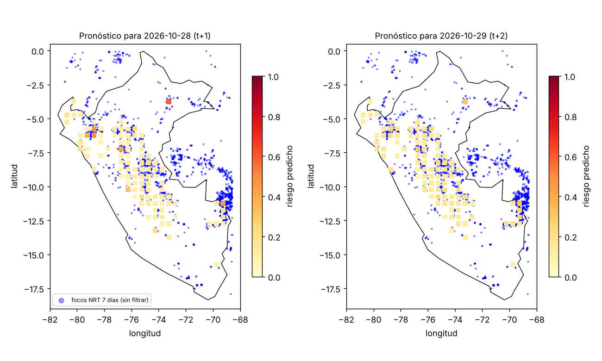

# deforescat — Predicción de focos de incendio a 1-2 días en Perú

Proyecto integrador: ¿se puede predecir, con datos satelitales públicos, en qué zonas de Perú habrá focos de calor al día siguiente (t+1) o a los dos días (t+2)?
Todo se calcula con **datos reales descargados** (ningún dato simulado). Resultados: [`docs/INFORME.md`](docs/INFORME.md) · Fuentes: [`docs/FUENTES.md`](docs/FUENTES.md) · Figuras: `docs/figures/`.



## 1. Flujo de punta a punta
```
download_data.py ──► data/raw/*.csv (focos FIRMS 2021-2025) + contorno de Perú
run_pipeline.py  ──► clima NASA POWER (cache data/weather/) ► panel celda-día ► validación por años
                     ► docs/resultados.json · docs/figures/01..07 · models/operacional_h{1,2}.joblib
predict.py       ──► focos NRT FIRMS (7 días) + clima ► outputs/pronostico_AAAA-MM-DD.csv · figura 08
predict.py --verify outputs/pronostico_X.csv ──► compara el pronóstico con lo que ocurrió después
```

## 2. Qué se hizo
1. **Focos reales** VIIRS S-NPP de Perú 2021-2025 (NASA FIRMS). Se excluyen detecciones de confianza baja y las que no son vegetación (`type != 0`). El archivo NRT (datos nuevos) usa palabras (`nominal/low/high`) y no trae `type`; el código lo normaliza.
2. **Cuadrícula** de 0.5° x 0.5° y conteo de focos por celda y día. Se modelan las 100 celdas con más focos, **elegidas solo con años anteriores al de prueba** (sin fuga).
3. **Clima real** por celda (NASA POWER): T2M_MAX, PRECTOTCORR, WS10M_MAX, RH2M, más lluvia acumulada 7 y 30 días.
4. **Variables**: focos acumulados 1/3/7(/14) días, día del año, clima. **Etiqueta**: ¿hay foco en la celda en t+1 (o t+2)?
5. **Tres variantes de modelo** (LightGBM) para entender qué aporta cada cosa:
   - `solo_focos`: historial de focos + estación (sin clima).
   - `investigacion`: focos + clima **del mismo día** (ideal; no usable en tiempo real).
   - `operacional`: clima **de t-7** y focos de ventanas ≤7 días. Es la única que se puede ejecutar con datos nuevos, porque NASA POWER publica con ~7 días de retraso y el archivo NRT de FIRMS cubre 7 días.
6. **Validación por años**: se prueba 2023, 2024 y 2025, cada uno con un modelo entrenado solo con años anteriores (se purgan los últimos h días de entrenamiento para que la etiqueta no vea el test). Comparación con la línea base de persistencia ("hubo foco hoy").
7. **Modelos finales** (`operacional`, 2021-2025) guardados en `models/` para predecir datos nuevos.

## 3. Versiones usadas (verificadas en PyPI)
Python 3.13/3.14 con **uv**; fijadas en `pyproject.toml`/`uv.lock`: pandas 3.1.0, numpy 2.5.4, scikit-learn 1.9.1, lightgbm 4.7.0, matplotlib 3.11.2, requests 2.34.2, pyarrow 26.0.0; dev: pytest 9.2.0, ruff 0.17.3.

## 4. Cómo ejecutarlo
```bash
uv sync
uv run python download_data.py     # ~25 MB de focos (sin clave)
uv run python run_pipeline.py      # 1ª vez: ~115 consultas de clima (varios minutos); luego usa caché
uv run python predict.py           # pronóstico con datos de hoy
uv run python predict.py --verify outputs/pronostico_AAAA-MM-DD.csv   # cuando ya haya datos de los días siguientes
uv run pytest -q && uv run ruff check .
```
Requiere acceso a `firms.modaps.eosdis.nasa.gov`, `power.larc.nasa.gov` y `raw.githubusercontent.com` (contorno).

## 5. Estructura
| Archivo | Función |
|---|---|
| `download_data.py` | Descarga focos anuales y contorno de Perú. |
| `src/deforescat/dataset.py` | Filtro de focos, celdas, panel diario, variables, etiqueta t+h, clima con retraso (`lag`). |
| `src/deforescat/weather.py` | Cliente NASA POWER con caché por celda. |
| `src/deforescat/model.py` | Variantes de variables, LightGBM, métricas (AP, AUC, precisión en el 10 % de mayor riesgo). |
| `src/deforescat/viz.py` | Todas las figuras. |
| `src/deforescat/firms.py` | Cliente de la API `area` de FIRMS (requiere `FIRMS_MAP_KEY`; no probado, sin clave). |
| `run_pipeline.py` | Entrenamiento, validación, modelos y figuras. |
| `predict.py` | Pronóstico con datos nuevos y verificación posterior. |
| `tests/` | Pruebas de lógica (etiqueta al futuro, confianza NRT, retraso del clima). |

## 6. Figuras (`docs/figures/`)
`01_mapa_focos` · `02_serie_mensual` · `03_validacion_por_anios` · `04_curvas_pr_roc` · `05_calibracion` · `06_importancia` · `07_mapa_riesgo_vs_real` · `08_pronostico_ultimo`.

## 7. Cómo seguir
- Otra zona o más celdas: `TOP_CELLS` y la lista de países en `download_data.py`.
- Mejores datos: NDVI MODIS, relieve SRTM, pronóstico meteorológico real (hoy el clima es observado y con retraso), comparación con EFFIS/GWIS.
- Seguimiento: ejecutar `predict.py` a diario y `--verify` después para acumular una evaluación en tiempo real.
